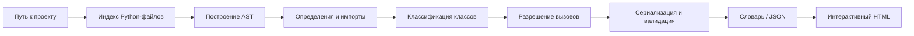

# Анализатор и визуализатор Python-проектов

## 1. Назначение

Этот набор модулей статически анализирует исходный код Python-проекта и строит интерактивную карту его архитектуры.

Он нужен, чтобы без запуска исследуемого приложения увидеть:

- из каких файлов состоит проект;
- какие классы, методы, функции и константы объявлены в каждом файле;
- какие классы наследуются друг от друга;
- какие объекты импортируются между локальными модулями;
- какие функции и методы вызывают друг друга;
- какие типы используются в полях классов;
- подробные данные каждого найденного элемента.

Анализ выполняется через стандартный модуль `ast`. Исследуемый код не импортируется и не исполняется. Это делает обработку предсказуемее и безопаснее, чем динамическое исследование проекта.

## 2. Быстрый запуск

Основная точка входа для готового сценария — `analyze_project.py`.

В начале файла задаются пять настроек:

```python
PROJECT_PATH = Path(r"C:\projects\my_project")
OUTPUT_HTML = Path(__file__).with_name("project_graph.html")
OUTPUT_METRICS = Path(__file__).with_name("graph_metrics.json")
OUTPUT_SOURCE_INDEX = Path(__file__).with_name("source_index.json")
OPEN_BROWSER = True
```

- `PROJECT_PATH` — корень анализируемого проекта;
- `OUTPUT_HTML` — путь итоговой интерактивной страницы;
- `OUTPUT_METRICS` — путь JSON-файла с полными метриками;
- `OUTPUT_SOURCE_INDEX` — путь поискового индекса исходного кода;
- `OPEN_BROWSER` — нужно ли открыть страницу после построения.

Рекомендуется указывать абсолютный путь и использовать raw-строку `r"..."`, чтобы обратные слеши Windows не интерпретировались как escape-последовательности.

Пример запуска из директории `gpt_work_dir`:

```powershell
cd C:\Users\Red0c\PycharmProjects\PiaPav\backend\app\algorithm\src\gpt_work_dir
python analyze_project.py
```

После выполнения создаются:

- HTML по адресу из `OUTPUT_HTML`;
- `graph.json` в текущей рабочей директории процесса.
- JSON с полным набором рассчитанных метрик по адресу из `OUTPUT_METRICS`.
- `source_index.json` с координатами исходных структур по адресу из
  `OUTPUT_SOURCE_INDEX`.

Формат и гарантии поискового индекса подробно описаны в
[`SOURCE_INDEX.md`](SOURCE_INDEX.md).

Важно: расположение `graph.json` зависит от текущей рабочей директории процесса
(`Path.cwd()`). Путь к метрикам задаётся явно через `OUTPUT_METRICS`.

### Компактный граф для передачи в нейросеть

Из директории `gpt_work_dir` запустите:

```powershell
python optimize_graph.py
```

Скрипт читает `graph.json` рядом с собой и создаёт `graph.min.json` в той же
директории. Он удаляет отступы, переносы строк и пробелы между элементами JSON,
сохраняя все поля, значения и пробельные символы внутри строк. Кириллица
сохраняется в UTF-8 без преобразования в `\uXXXX`. Исходный файл сохраняется.

Можно указать другой входной файл и путь результата:

```powershell
python optimize_graph.py path/to/graph.json -o path/to/compact.json
```

Относительные пути отсчитываются от текущей рабочей директории. Без `-o`
результат сохраняется рядом со входным файлом с суффиксом `.min.json`.
Скрипт выводит экономию в байтах и токенах DeepSeek V4 Flash.

### Подсчёт токенов DeepSeek V4 Flash

Для трёх скриптов `optimize_graph.py`, `optimize_metrics.py` и
`count_directory_tokens.py` установите зависимость из директории `app/algorithm`:

```powershell
uv add "tokenizers>=0.22,<0.24"
uv run python src/gpt_work_dir/count_directory_tokens.py "C:\projects\my_project"
```

Без аргумента последний скрипт запросит директорию в консоли. Он рекурсивно
суммирует токены текстовых файлов UTF-8, включая скрытые файлы. Бинарные файлы
(по ошибкам декодирования или управляющим символам) пропускаются с сообщением.

Модуль `token_counting.py` использует официальный токенизатор
`deepseek-ai/DeepSeek-V4-Flash`. При первом запуске нужен интернет для загрузки
токенизатора из Hugging Face в кеш. Веса модели не загружаются; текст файлов
обрабатывается локально. Переносы строк CRLF/LF сохраняются при подсчёте.

Имена файлов, разделители, инструкции и служебные токены чата не включены.
Сумма по отдельным файлам может отличаться от токенизации объединённого запроса.
Фактический расход API проверяется по `usage`; версия токенизатора API может
отличаться от опубликованной. Источники:
https://huggingface.co/deepseek-ai/DeepSeek-V4-Flash и
https://api-docs.deepseek.com/quick_start/token_usage/.

## 3. Программное использование

### Только анализ

```python
from gpt_work_dir.parser import starter

graph = starter(r"C:\projects\my_project")
```

`starter()` принимает строку или `pathlib.Path` и возвращает JSON-совместимый словарь.

### Анализ и создание страницы

```python
from gpt_work_dir.analyze_project import build_project_graph

result = build_project_graph(
    project_path=r"C:\projects\my_project",
    output_html="project_graph.html",
    output_metrics="graph_metrics.json",
    open_browser=True,
)

print(result)
```

### Визуализация уже готового JSON

```powershell
python -m gpt_work_dir.parser.visualizer graph.json -o project_graph.html --open
```

Или из Python:

```python
from gpt_work_dir.parser import visualize_graph

visualize_graph("graph.json", "project_graph.html", open_browser=True)
```

Визуализатор принимает:

- словарь;
- путь к JSON-файлу;
- JSON-строку;
- `-` в CLI для чтения JSON из стандартного ввода.

## 4. Общая схема работы



Обработка разделена на проходы намеренно. Например, вызов из первого файла может ссылаться на класс из последнего файла. Если анализировать всё за один проход, этот класс может быть ещё неизвестен.

## 5. Этапы анализа

### 5.1. Индексация проекта

`parser/logic/project_index.py`:

1. Проверяет, что переданный путь существует и является директорией.
2. Рекурсивно находит `.py`-файлы.
3. Исключает служебные каталоги: `__pycache__`, `.git`, `.venv`, `venv`, `.pytest_cache`, `node_modules` и другие.
4. Вычисляет относительный путь и полное имя каждого модуля.
5. Читает исходники как UTF-8 и строит `ast.Module`.

Индекс использует полные модульные пути. Поэтому `a.models` и `b.models` считаются разными модулями, даже если оба файла называются `models.py`.

Для импортов с длинным префиксом применяется сопоставление по полному суффиксу. Благодаря этому импорт вида `some.repository.package.models` может быть сопоставлен с локальным `models`, если корень анализа выбран глубже корня репозитория.

### 5.2. Сбор импортов

`parser/logic/imports.py` поддерживает:

```python
import package
import package as alias
from package import Object
from package import Object as Alias
from .package import Object
```

Для каждого импорта сохраняются:

- настоящее имя объекта;
- локальный алиас;
- исходный модуль;
- разрешённый локальный модуль;
- признак `from_lib`.

`from_lib: true` означает, что модуль не найден внутри анализируемого проекта и считается внешним.

### 5.3. Сбор определений

`parser/logic/definitions.py` извлекает:

- классы и их родителей;
- функции и методы;
- позиционные, variadic и keyword-only аргументы;
- значения аргументов по умолчанию;
- возвращаемые типы;
- поля класса;
- присваивания `self.<field>` внутри `__init__`;
- простые константы уровня модуля.

Модульной константой считается прямое присваивание простого значения на уровне файла, например:

```python
API_NAME: str = "service"
RETRIES = 3
SUPPORTED = ["json", "yaml"]
```

Локальная переменная функции константой файла не считается.

### 5.4. Классификация классов

`parser/logic/classifiers.py` назначает каждому классу один из типов:

- `dataclass` — присутствует декоратор `@dataclass`;
- `enum` — класс наследуется от `Enum`;
- `abstract` — наследуется от `ABC` или не реализует известные абстрактные методы;
- `class` — обычный конкретный класс.

Классификация запускается после сбора всех классов. Это позволяет проверять многоуровневое наследование и отличать абстрактного потомка от класса, реализовавшего все обязательные методы.

### 5.5. Разрешение вызовов

`parser/logic/calls.py` сохраняет каждый `ast.Call` и пытается определить его цель.

Поддерживаются следующие случаи:

```python
SomeClass()                 # SomeClass.__init__
SC()                        # SomeClass.__init__, если SC — алиас
instance.create()           # SomeClass.create, если тип instance известен
module.function()           # синтаксическое или разрешённое имя
outer(inner())              # вложенный вызов сохраняется в аргументе outer
```

Простое распространение типов работает через присваивания:

```python
service = SomeService()
service.run()
```

После первого выражения область видимости запоминает тип `service`, поэтому второй вызов связывается с `SomeService.run`.

Если цель нельзя определить надёжно, сохраняется её синтаксическое имя. Анализатор не создаёт вымышленную связь.

### 5.6. Сериализация и проверка

`parser/logic/serializer.py` преобразует внутренние dataclass-модели в публичный словарь.

`parser/logic/validation.py` проверяет:

- наличие списка `body`;
- уникальность файлов;
- структуру импортов;
- допустимые типы классов;
- наличие списков методов;
- возможность сериализации через `json.dumps`.

Проверка выполняется до возврата результата из `starter()`.

## 6. Формат графа

Корень результата:

```json
{
  "body": [
    {
      "file": {
        "name": "models",
        "path": "domain",
        "path_parts": ["domain"]
      }
    }
  ]
}
```

Объект файла может содержать:

| Поле | Назначение |
|---|---|
| `name` | Имя файла без `.py` |
| `path` | Пакетный путь через точки |
| `path_parts` | Каталоги исходного проекта отдельными сегментами; используется для точной иерархической раскладки |
| `imports` | Импорты файла |
| `constants` | Простые значения уровня модуля |
| `classes` | Классы |
| `functions` | Функции уровня модуля |
| `calls` | Вызовы в исполняемом коде уровня модуля |

Необязательные пустые секции могут отсутствовать.

### Класс

```json
{
  "name": "Service",
  "parent": "BaseService",
  "type": "class",
  "fields": [],
  "methods": []
}
```

### Функция или метод

```json
{
  "name": "create",
  "args": [
    {
      "name": "value",
      "type": "str",
      "value": null
    }
  ],
  "return_type": "Result",
  "calls": []
}
```

`self` и `cls` не выводятся как публичные аргументы метода.

### Вызов

```json
{
  "object": "Repository.save",
  "args": [
    {
      "name": "item",
      "value": "entity"
    }
  ]
}
```

Вложенный вызов хранится непосредственно в значении аргумента:

```json
{
  "name": "item",
  "value": {
    "type": "call",
    "object": "Entity.__init__",
    "args": []
  }
}
```

### Типы полей

Простой тип хранится строкой:

```json
"type": "str"
```

Generic-аннотация хранится компактным объектом:

```json
"type": {
  "parent": "list",
  "child": "Cell"
}
```

Вложенные generic-типы могут образовывать вложенные объекты, например для `Optional[list[str]]`. Визуализатор обрабатывает их рекурсивно.

## 7. Визуализация

`parser/visualizer/` создаёт автономный HTML. Для открытия результата не нужны сервер, npm или внешние JavaScript-библиотеки.

### Группировка

Каталоги отображаются вложенными контейнерами в соответствии с `path_parts`. Файлы корня находятся в контейнере «Корень проекта», а файлы дочерних папок — внутри соответствующих вложенных рамок. Каждый Python-файл отображается отдельным прямоугольным контейнером. Внутри элементы расположены вертикально:

1. класс;
2. сразу под ним его методы;
3. следующий класс и его методы;
4. функции;
5. константы;
6. код уровня модуля.

Поля класса и отдельные callsite не создают лишних узлов. Они доступны в подробностях и используются для построения связей.

### Связи

Визуализатор строит стрелки:

| Подпись | Значение |
|---|---|
| `вызывает` | Функция, метод или модуль вызывает другой локальный объект |
| `импортирует` | Локальный модуль импортирует класс, функцию или другой модуль проекта |
| `наследует` | Класс наследуется от другого класса проекта |
| `поле <name>` | Поле класса ссылается на другой известный класс |

Несколько одинаковых отношений объединяются и получают счётчик `×N`.

Импорты внешних библиотек не получают стрелку, потому что соответствующего узла внутри проекта нет. Они остаются в подробностях файла и узла кода модуля.

### Управление

- колесо мыши — масштабирование;
- перетаскивание пустой области — перемещение всей схемы;
- перетаскивание контейнера каталога — перемещение каталога вместе со всеми вложенными каталогами и файлами;
- перетаскивание контейнера файла — изменение его позиции;
- `Показать целиком` — автоматическое вписывание схемы;
- нажатие на файл или узел — открытие панели подробностей;
- крестик или нажатие на пустую область — закрытие панели.

Линии связей располагаются поверх фона файлов, а узлы и подписи — поверх линий. Поэтому начало и конец каждой связи видны.

### Защита от пустой страницы

Построение HTML обёрнуто в обработчик JavaScript-ошибок. Если встретится неподдержанный формат данных, вместо пустого экрана будет показано сообщение `Не удалось построить граф: ...`.

JSON перед вставкой в `<script type="application/json">` экранирует HTML-значимые символы. Это предотвращает преждевременное закрытие тега содержимым анализируемого проекта.

## 8. Структура исходного кода

| Файл | Ответственность |
|---|---|
| `analyze_project.py` | Готовый запуск анализа, сохранение JSON и создание HTML |
| `graph_metrics/calculator.py` | Размер проекта, активность и математические метрики графа зависимостей |
| `graph_metrics/architecture.py` | Связность пакетов, критические файлы и мосты зависимостей |
| `graph_metrics/call_graph.py` | Граф функций и методов, цепочки вызовов, рекурсия и центральность вершин |
| `graph_metrics/quality.py` | Сложность, вложенность, async и поток исключений |
| `graph_metrics/object_metrics.py` | Объектные метрики WMC, CBO, RFC, LCOM, DIT и NOC |
| `graph_metrics/serialization.py` | Сохранение полных метрик и обратимое компактное представление для LLM |
| `optimize_metrics.py` | CLI для создания компактного JSON метрик |
| `parser/__init__.py` | Общий публичный фасад двух подсистем |
| `parser/logic/main.py` | Минимальный публичный API парсера |
| `parser/logic/analyzer.py` | Оркестрация проходов |
| `parser/logic/project_index.py` | Файлы, модули и разрешение локальных путей |
| `parser/logic/models.py` | Внутренние dataclass-модели фактов |
| `parser/logic/imports.py` | Сбор импортов |
| `parser/logic/definitions.py` | Классы, функции, методы, поля и константы |
| `parser/logic/classifiers.py` | `dataclass`, `Enum`, ABC и обычные классы |
| `parser/logic/scope.py` | Области видимости и известные типы переменных |
| `parser/logic/calls.py` | Сбор и разрешение вызовов |
| `parser/logic/expressions.py` | Преобразование AST-выражений и аннотаций |
| `parser/logic/serializer.py` | Публичный формат графа и `save_graph()` |
| `parser/logic/validation.py` | Проверка результата, включая `path_parts` |
| `parser/logic/errors.py` | Предметные исключения |
| `parser/visualizer/renderer.py` | Построение автономного интерактивного HTML и иерархическая раскладка |
| `parser/visualizer/__main__.py` | CLI визуализатора |
| `tests/test_parser.py` | Golden-тест и граничные случаи парсера |
| `tests/test_visualizer.py` | Тесты генерации страницы и единой точки входа |
| `tests/test_metrics_serialization.py` | Тесты сохранения, сжатия и восстановления метрик |

Разделение обязанностей нужно, чтобы изменение визуального представления не влияло на AST-анализ, а изменение внутреннего анализа не требовало переписывать файловый обход.

### Математические метрики

`analyze_project.py` выводит семь разделов. Под `callable` далее понимается функция или метод; код уровня модуля считается отдельным владельцем вызовов только там, где это указано явно. Все списки `top` содержат не более десяти элементов.

#### `size` — размер проекта

| Поле | Значение |
|---|---|
| `directories` | Число уникальных каталогов с учётом всех уровней вложенности, без корня проекта |
| `files` | Число проанализированных `.py`-файлов |
| `classes` | Все классы, включая dataclass, Enum и абстрактные классы |
| `abstract_classes` | Классы с абстрактными методами или наследованием от ABC |
| `dataclasses` | Классы с декоратором `@dataclass` |
| `functions` | Функции уровня модуля |
| `methods` | Методы классов, включая `__init__` |
| `fields` | Обнаруженные поля классов и `self.<field>` из конструкторов |
| `constants` | Простые константы уровня модуля |

Раздел описывает масштаб, но не качество. Сравнивать его полезнее между версиями одного проекта: резкий рост классов, полей или файлов может указывать на усложнение архитектуры.

#### `activity` — интенсивность взаимодействий

| Поле | Формула или смысл |
|---|---|
| `calls` | Все callsite, включая повторные и синтаксически вложенные вызовы |
| `local_imports` | Импорты объектов из анализируемого проекта |
| `external_imports` | Импорты стандартной библиотеки и сторонних пакетов |
| `average_calls_per_callable` | Вызовы внутри функций и методов / число функций и методов |
| `average_calls_per_call_owner` | Все вызовы / число функций, методов и модулей, содержащих вызовы |
| `average_methods_per_class` | Методы / классы |

Высокие средние значения обозначают насыщенность взаимодействиями, но не являются ошибкой сами по себе: orchestration/service-код закономерно вызывает больше объектов, чем модели данных.

#### `dependency_graph` — зависимости файлов

Вершина — Python-файл, ребро `A → B` — хотя бы один локальный импорт файла `B` из `A`. Повторные импорты одной пары образуют одно ребро.

| Поле | Интерпретация |
|---|---|
| `nodes`, `edges` | Число файлов и уникальных направленных зависимостей |
| `density` | `E / (N × (N − 1))`, диапазон `0..1`; близость к `1` означает сильную связанность файлов |
| `average_fan_in` | Среднее число файлов, зависящих от одного файла |
| `average_fan_out` | Среднее число файлов, от которых зависит один файл |
| `weakly_connected_components` | Количество частей графа после игнорирования направления рёбер; `1` означает связный проект |
| `isolated_files` | Файлы без входящих и исходящих локальных зависимостей |
| `cyclic_components` | Группы файлов со взаимно достижимыми импортами; непустой список указывает на циклы |
| `highest_fan_in` | Наиболее востребованные файлы; изменения имеют широкий радиус воздействия |
| `highest_fan_out` | Файлы с наибольшим числом зависимостей; кандидаты на проверку ответственности |

Низкая плотность обычно желательна, но универсального порога нет. `fan-in` и `fan-out` следует сравнивать с ролью файла: высокий `fan-in` нормален для стабильного логгера, высокий `fan-out` — для точки сборки приложения.

#### `architecture` — пакеты и критическая топология

Пакетом считается первый каталог относительно корня анализа; файлы непосредственно в корне относятся к `<root>`.

| Поле пакета | Формула и смысл |
|---|---|
| `afferent_coupling` (`Ca`) | Число других пакетов, зависящих от данного; мера ответственности и стабильности |
| `efferent_coupling` (`Ce`) | Число других пакетов, от которых зависит данный |
| `instability` (`I`) | `Ce / (Ca + Ce)`; `0` — максимально стабильный, `1` — максимально зависимый пакет |
| `abstractness` (`A`) | Абстрактные классы / все классы пакета; диапазон `0..1` |
| `distance_from_main_sequence` (`D`) | `|A + I − 1|`; `0` — баланс стабильности и абстрактности, `1` — максимальное отклонение |

Остальные поля раздела:

| Поле | Значение |
|---|---|
| `package_edges` | Уникальные зависимости между пакетами |
| `cyclic_package_components` | Пакеты, образующие взаимные циклы; пакетный цикл возможен даже без прямого цикла двух файлов |
| `articulation_files` | Файлы, удаление которых увеличивает число связных компонент; архитектурные точки сочленения |
| `bridge_dependencies` | Единичные связи, удаление которых разрывает часть файлового графа |

Высокий `D` — повод проверить пакет, но не автоматический дефект. Например, стабильный конкретный пакет DTO может закономерно иметь `A = 0`, `I = 0`, `D = 1`.

#### `code_quality` — сложность и поток управления

| Поле | Значение |
|---|---|
| `analyzed_callables` | Число функций и методов с рассчитанными AST-метриками |
| `average_cyclomatic_complexity` | Среднее число независимых путей выполнения; каждая ветвь увеличивает показатель |
| `average_cognitive_complexity` | Средняя оценка трудности чтения; вложенные условия и циклы штрафуются сильнее |
| `average_lines_per_callable` | Средний физический размер функции или метода вместе с сигнатурой |
| `maximum_control_nesting` | Максимальная глубина вложенных `if`, циклов, `try`, `match` и comprehension |
| `high_complexity_callables` | Функции с цикломатической сложностью `≥ 10` или когнитивной `≥ 15` |
| `largest_callables` | Десять самых длинных функций и методов по LOC |
| `deeply_nested_callables` | Callable с управляющей вложенностью `≥ 4` |

Цикломатическая сложность приблизительно задаёт минимальное число тестовых путей. Когнитивная лучше отражает читаемость. Значения рассчитаны статически и не учитывают сложность вызываемых функций.

В подразделе `async`:

| Поле | Значение |
|---|---|
| `functions` | Количество `async def` |
| `without_await` | Асинхронные функции без `await`; возможная лишняя асинхронность, но также допустимый интерфейс или framework-hook |

В подразделе `exceptions`:

| Поле | Значение |
|---|---|
| `raise_statements` | Количество операторов `raise` |
| `callables_raising` | Число функций и методов хотя бы с одним `raise` |
| `raised_types`, `caught_types` | Частота создаваемых и перехватываемых выражений исключений |
| `broad_handlers` | Обработчики `Exception`, `BaseException` и `bare except`; требуют проверки, не скрываются ли ошибки |

Имя вроде `e` в `raised_types` означает динамическое `raise e`, а не класс исключения. Повторный `raise` без выражения учитывается в общем количестве, но не добавляет тип.

#### `object_oriented` — метрики классов

Каждая рейтинговая запись содержит полный набор показателей класса:

| Метрика | Расчёт | Интерпретация высокого значения |
|---|---|---|
| `wmc` | Сумма цикломатической сложности методов | Большая внутренняя сложность класса |
| `cbo` | Число уникальных связанных классов | Сильное зацепление и широкий радиус изменений |
| `rfc` | Методы класса + уникальные вызываемые ими объекты | Большая потенциальная реакция на один публичный вызов |
| `lcom` | Доля пар методов, не использующих общие поля; `0..1` | Низкая связность обязанностей класса |
| `dit` | Максимальная глубина локальной цепочки наследования | Более сложное понимание и переопределение поведения |
| `noc` | Число непосредственных локальных наследников | Родитель имеет широкий радиус воздействия |

`lcom = null` означает, что показатель неприменим: у класса меньше двух методов либо парсер не обнаружил поля экземпляра. Это не равно плохой или идеальной связности.

Списки `highest_weighted_method_complexity`, `highest_class_coupling`, `largest_response_sets`, `lowest_cohesion`, `deepest_inheritance` и `most_direct_children` сортируют классы по соответствующей метрике.

#### `call_graph` — граф вызовов

Вершины имеют квалифицированные имена `package.module.Class.method`. В граф входят функции, методы, неявные конструкторы и код модулей (`__module__`). Ребро `A → B` означает, что тело `A` содержит статически разрешённый вызов `B`.

| Поле | Значение |
|---|---|
| `nodes`, `edges` | Число callable-вершин и уникальных направленных рёбер |
| `callsites_in_local_edges` | Все локально разрешённые callsite; может быть больше `edges` из-за повторных вызовов |
| `external_or_builtin_callsites` | Вызовы, уверенно отнесённые к импортированной библиотеке или builtin |
| `unresolved_callsites` | Вызовы, для которых нельзя надёжно выбрать локальную или внешнюю цель |
| `unresolved_or_external_callsites` | Сумма двух предыдущих категорий для обратной совместимости |
| `local_resolution_rate` | Локально разрешённые callsite / все callsite |
| `classified_callsite_rate` | Локально разрешённые + известные внешние / все callsite |
| `heaviest_edges` | Пары caller/target с максимальным числом callsite |
| `entrypoints` | Вершины с исходящими, но без входящих рёбер |
| `leaf_callables` | Вызываемые вершины без распознанных локальных вызовов |
| `isolated_callables` | Вершины без распознанных входящих и исходящих рёбер |
| `highest_fan_in`, `highest_fan_out` | Вершины с максимальным числом уникальных вызывающих или вызываемых соседей |
| `maximum_transitive_reach` | Максимальное число вершин, достижимых по цепочкам вызовов |
| `maximum_call_chain_depth` | Число рёбер в самой длинной цепочке между компонентами рекурсии |
| `longest_call_chain` | Одна из найденных максимальных цепочек `A → B → …` |
| `maximum_syntactic_call_nesting` | Глубина выражения `A(B(C()))`; не равна транзитивной глубине графа |
| `deepest_nested_call_owners` | Функции, содержащие максимально вложенное выражение вызовов |
| `recursive_components` | Прямая рекурсия или группы взаимно рекурсивных callable |
| `pagerank_top` | Наиболее значимые цели вызовов; сумма PageRank всех вершин приблизительно равна `1` |
| `betweenness_top` | Посредники, через которые проходит наибольшая доля кратчайших цепочек |
| `node_kinds` | Количество функций, методов, модулей и синтетических конструкторов |

`entrypoints` и `isolated_callables` — кандидаты, а не доказательство публичности или мёртвого кода. Framework, dependency injection, декораторы и динамические вызовы могут находиться за пределами статического графа. Достоверность центральностей следует оценивать вместе с `local_resolution_rate` и `classified_callsite_rate`.

##### Рейтинг риска

`risk_top` объединяет четыре нормализованных внутри текущего проекта фактора:

```text
risk = 100 × (
    0.35 × complexity
  + 0.25 × fan_in
  + 0.20 × betweenness
  + 0.20 × transitive_reach
)
```

`complexity` строится из цикломатической сложности сверх базового пути и когнитивной сложности. `fan_in` отражает радиус воздействия, `betweenness` — роль посредника, `transitive_reach` — ширину downstream-цепочки.

Рейтинг предназначен для приоритизации ревью и тестирования. Это относительный балл внутри одного запуска: его корректно сравнивать между вершинами одного проекта, но не как абсолютную оценку качества разных проектов.

Метрики можно использовать отдельно:

```python
from gpt_work_dir.graph_metrics import calculate_graph_metrics

metrics = calculate_graph_metrics(graph)
```

### Компактный JSON метрик для нейросети

Пути задаются константами в начале `optimize_metrics.py`:

```python
INPUT_METRICS = Path(__file__).with_name("graph_metrics.json")
OUTPUT_METRICS = Path(__file__).with_name("graph_metrics.optimized.json")
```

После их настройки скрипт запускается без аргументов командной строки:

```powershell
python optimize_metrics.py
```

Скрипт удаляет только форматирующие пробелы. Повторяющиеся списки однотипных
объектов он заменяет представлением `{"$columns": [...], "$rows": [...]}`, если
оно занимает меньше места. `null`, числовые нули и пустые списки сохраняются,
так как они могут быть значимыми метриками. Ключи одиночных объектов не
сокращаются, поэтому структура остаётся понятной модели без отдельной схемы.

После обработки в консоли выводятся размеры и примерное количество токенов до
и после оптимизации. Автономная оценка использует соотношение `1 токен ≈ 4
байта UTF-8`; точное число может отличаться в зависимости от токенизатора
конкретной модели.

Программный API также позволяет восстановить исходную структуру:

```python
from gpt_work_dir.graph_metrics import compact_graph_metrics, restore_graph_metrics

compact = compact_graph_metrics(metrics)
assert restore_graph_metrics(compact) == metrics
```

## 9. Ошибки

Парсер использует предметные исключения:

| Исключение | Причина |
|---|---|
| `ProjectNotFoundError` | Переданная директория не существует |
| `SourceReadError` | Исходный файл не удалось прочитать |
| `SourceSyntaxError` | В исходнике синтаксическая ошибка; содержит файл, строку и колонку |
| `GraphValidationError` | Итоговая структура нарушает контракт графа |

Пример обработки:

```python
from gpt_work_dir.parser import starter
from gpt_work_dir.parser.logic.errors import ParserError

try:
    graph = starter(project_path)
except ParserError as error:
    print(f"Анализ не выполнен: {error}")
```

## 10. Ограничения

Анализатор намеренно не является полноценным интерпретатором Python.

Он не гарантирует точное разрешение:

- динамических импортов;
- `getattr()` с вычисляемым именем;
- monkey patching;
- зависимостей, созданных через runtime-контейнеры;
- сложного data flow между всеми ветками программы;
- вызовов сторонних библиотек;
- типов, вычисляемых метаклассами и декораторами во время исполнения.

Если статически надёжного ответа нет, сохраняется синтаксическое имя. Такой подход лучше ложной точности: граф показывает подтверждённые связи и не выдумывает отсутствующие объекты.

Для очень большого проекта количество файлов и связей может сделать схему плотной. Контейнеры можно вручную перетаскивать, а отдельные детали всегда доступны через панель узла.

## 11. Тестирование

Из директории `backend/app/algorithm/src`:

```powershell
python -B -m unittest discover -s gpt_work_dir\tests -p "test_*.py" -v
```

Набор тестов проверяет:

- полное совпадение `project1` с эталонным `graph.json`;
- детерминированность результата;
- абсолютные и относительные импорты;
- одинаковые имена модулей в разных пакетах;
- классификацию абстрактных классов;
- вложенные и повторные вызовы;
- распространение типа после конструктора;
- модульные константы;
- синтаксические ошибки с позицией;
- безопасное встраивание JSON в HTML;
- единую точку запуска анализа и визуализации.

## 12. Как расширять проект

### Новый факт анализа

Рекомендуемый порядок:

1. Добавить внутреннюю модель или поле в `parser/logic/models.py`.
2. Извлечь факт из AST в `definitions.py`, `imports.py` или `calls.py`.
3. Добавить его в `serializer.py`.
4. Расширить `validation.py`, если поле обязательное.
5. Добавить минимальный тестовый исходник.
6. При необходимости отобразить факт в `parser/visualizer/renderer.py`.

### Новая связь в визуализации

Связь должна строиться только тогда, когда найдены оба реальных локальных узла. Если целевой объект внешний или неоднозначный, его лучше оставить в подробностях, чем соединить с объектом только из-за совпадения короткого имени.

### Изменение публичного JSON

Формат JSON является контрактом между парсером и визуализатором. При его изменении нужно одновременно обновить:

- сериализатор;
- валидатор;
- визуализатор;
- golden-файл;
- тесты обратной совместимости.

## 13. Требования

- Python 3.10 или новее;
- современный браузер с поддержкой SVG и стандартного JavaScript;
- сторонние Python- и JavaScript-зависимости не требуются.
